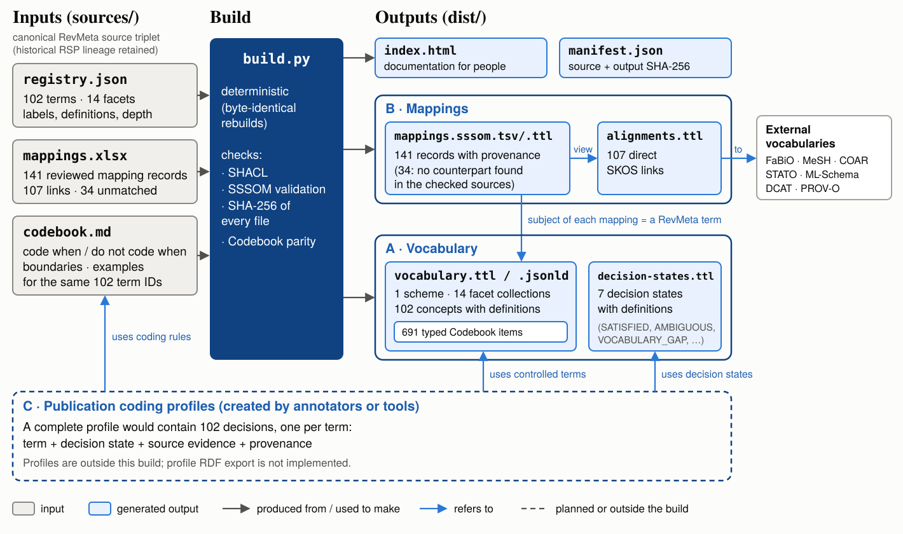
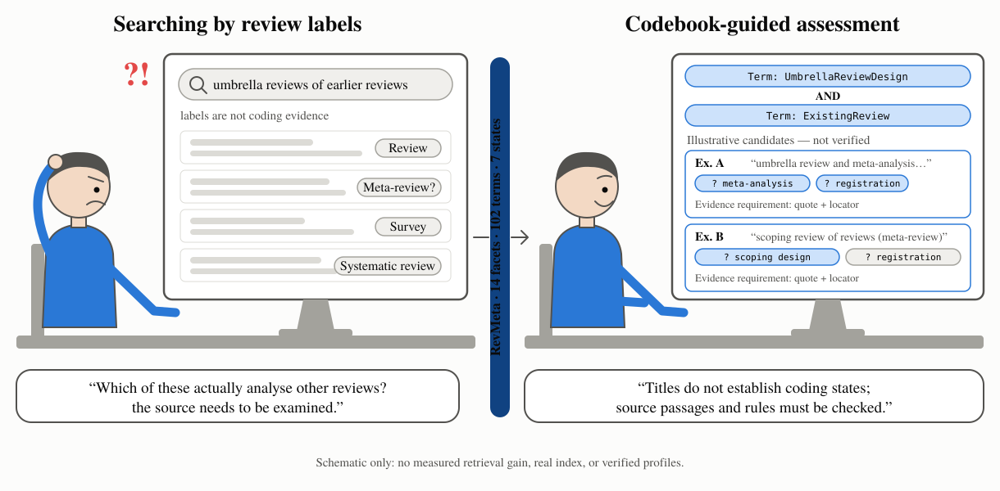
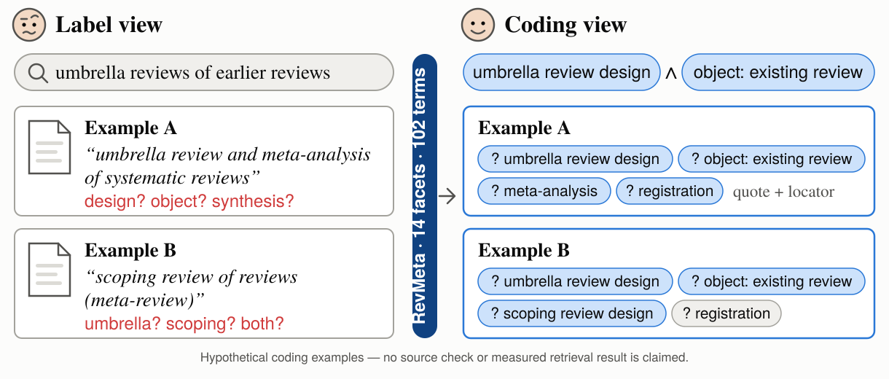

# RevMeta — User Guide

RevMeta (*Review Metadata*) is a controlled vocabulary for describing methodological features of review publications. It contains **102 terms across 14 facets**, with a machine-readable Codebook containing **691 coding-instruction items** and a separate scheme of **seven decision states**. The resource also provides **141 curated mapping records** (107 concrete external links and 34 unmatched records). It is a **SKOS-based data resource, not an OWL reasoning ontology**.

This single guide is the user-facing entry point. It covers rebuilding the artifacts, interpreting the vocabulary and coding rules, reading SSSOM mappings, and checking provenance. The three diagrams below are illustrations of the resource and coding workflow, not empirical results.

**Resource identity:** `VERSION=1.0.0` identifies the reproducible resource version. The author licenses RevMeta project-owned sources, generator and figures under Apache-2.0. Publication status is determined by a specific tagged **public GitHub Release**, not by the build manifest. Verify the actual `https://w3id.org/revmeta/` registration and redirects before relying on persistent URI resolution; this guide does not claim independent scientific validation, DOI registration or a publication-profile exporter.



*Figure 1. The generator reads three frozen sources and produces eight deterministic files. Publication coding profiles, created separately by annotators or tools, use controlled vocabulary terms, decision states and Codebook coding rules (blue arrows). Publication-level profiles are outside this build.*

### Contents

- [Build and verify](#build-and-verify-locally)
- [Machine-readable Codebook](#machine-readable-codebook)
- [Seven coding states](#seven-coding-decision-states)
- [Illustrative coding diagrams](#illustrative-coding-diagrams)
- [Mapping interpretation](#mapping-and-interpretation-policy)
- [Provenance and release conditions](#provenance-licensing-and-release-status)

---


## Build and verify locally

These commands rebuild the current resource. Running them does not publish or license the result.

Requirements: Python 3.12, Python dependencies declared in `pyproject.toml`, and the three authoritative source files in `resources/inputs/vocabulary/`.

From the repository root:

```bash
python -m pip install -e ".[validation]"
PYTHONPATH=src python -m unittest discover -s tests/build -v
python -m revmeta build --require-complete
python -m pyshacl -s src/revmeta/build/shapes/vocabulary.shacl.ttl -df turtle -sf turtle resources/outputs/vocabulary/vocabulary.ttl
sssom validate resources/outputs/vocabulary/mappings.sssom.tsv
```

Outputs:
- `resources/outputs/vocabulary/index.html`: static, source-backed HTML documentation with valid facet and concept anchors.
- `resources/outputs/vocabulary/vocabulary.ttl`: SKOS graph enriched with all 691 Codebook coding items, 14 defined facet collections, source fingerprints and resource version (see [machine-readable Codebook contract](#machine-readable-codebook)).
- `resources/outputs/vocabulary/vocabulary.jsonld`: RDF-isomorphic alternate serialization including every source-derived Codebook item.
- `resources/outputs/vocabulary/decision-states.ttl`: seven epistemic coding states in a separate SKOS scheme, not part of the 102 methodological terms. See the [decision-state coding guide](#seven-coding-decision-states) for definitions and evidence requirements.
- `resources/outputs/vocabulary/mappings.sssom.tsv`: full 141 source mapping records, including 34 unmatched sentinels.
- `resources/outputs/vocabulary/mappings.sssom.ttl`: 141 metadata-bearing SSSOM/RDF mapping records, including 34 unmatched records, without direct SKOS triples.
- `resources/outputs/vocabulary/alignments.ttl`: 107 concrete RDF/SKOS mapping statements only.
- `resources/outputs/vocabulary/manifest.json`: input/output SHA-256 hashes and completeness flag.

The canonical Codebook is required even for development RDF builds; generation fails closed if it is missing or cannot be parsed. Builds without a mappings workbook may be incomplete and are **not release-ready**. Generated artifacts are never hand edited.

The canonical IRI prefix is `https://w3id.org/revmeta/`; it only becomes an operational persistent identifier after registration and verification of live redirects. The version number alone is not a DOI or independent quality certification.

See [provenance, version and license status](#provenance-licensing-and-release-status) and the [mapping interpretation policy](#mapping-and-interpretation-policy). An offline **candidate** may be staged with `revmeta release stage --output /absolute/path/outside/repo`; this is not a publication action. A verified public GitHub Release/tag establishes publication status; W3ID resolution must be checked independently.

---

## Machine-readable Codebook

The full, frozen term-specific Codebook is exported into the **same RDF
graph** as the methodological vocabulary: `resources/outputs/vocabulary/vocabulary.ttl`
and `resources/outputs/vocabulary/vocabulary.jsonld`. Both serializations are
RDF-isomorphic. This is a data/documentation representation, **not**
a publication-level reasoning ontology or a new scientific source revision.

### Concepts and coding instructions

Every one of the 102 `skos:Concept` term nodes has five
distinct categories of linked coding items:

| RevMeta predicate | Source Codebook section | Frozen source items |
| --- | --- | ---: |
| `revmeta:codeWhen` | CODE WHEN | 134 |
| `revmeta:doNotCodeWhen` | DO NOT CODE WHEN | 193 |
| `revmeta:boundaryNote` | Boundary notes | 155 |
| `revmeta:positiveExample` | Positive examples | 104 |
| `revmeta:negativeExample` | Negative examples | 105 |

Total: **691** distinct guidance nodes. Each link points to a
`revmeta:CodingGuidanceItem`, carrying an English-language
`rdf:value` literal with **exact original Markdown bullet text**,
`revmeta:itemIndex` (1-based order *within a category*) and
`revmeta:sourceLine` (1-based Codebook Markdown line).
The item IRIs are deterministic and encode term, category and position.

Example pattern (illustrative notation; use source values from RDF):
```turtle
revmeta:hasReviewDesign.SystematicReviewDesign
    revmeta:codeWhen
      <https://w3id.org/revmeta/guidance/hasReviewDesign.SystematicReviewDesign/codeWhen/001> .

<https://w3id.org/revmeta/guidance/hasReviewDesign.SystematicReviewDesign/codeWhen/001>
    a revmeta:CodingGuidanceItem ;
    rdf:value "Source wording, verbatim"@en ;
    revmeta:itemIndex 1 ;
    revmeta:sourceLine 123 .
```

Codebook rules express **criteria for evidence-based coding**, not automatic
affirmative or negative conclusions about any publication. Particularly,
`doNotCodeWhen` is not a closed-world negation axiom.
No class hierarchy, `owl:equivalentClass` or facet OWL properties are inferred.

### Facet definitions and vocabulary provenance

The 14 existing `skos:Collection` nodes have human-readable
labels, verbatim `skos:definition` values and their
source boundaries as `skos:scopeNote`.
Their original facet CURIEs remain in `skos:notation`, with
technical names in `skos:altLabel`. They remain collections,
**not** OWL object properties.

The scheme records the **resource version** using
`dcterms:hasVersion`, and source records linked with
`dcterms:source`. Each source record carries
`dcterms:identifier` (stable logical ID: `registry`, `codebook`, or `mappings`)
and `revmeta:sha256` (exact source bytes). The manifest
also records the same input hashes. Current registry and Codebook metadata identify **RevMeta source revision 2**.
Earlier historical identifiers remain only in the private revision archive,
not in current published-resource metadata.

### Validation, compatibility and release status

`src/revmeta/build/codebook.py` fails closed on
unexpected content, duplicate fields/sections, missing facets/terms or
changes to the five approved item counts. It compares each source term's
identifier, label, definition and depth with the canonical registry.
Tests reconstruct all 691 statements from RDF and compare **every**
`rdf:value` with the original line; they also check
order, roles, facet coverage and source SHA-256. SHACL validates minimum
cardinalities and typed data. The generated HTML renders these instructions
directly from the RDF, not from a separate hardcoded copy.

The IRI prefix requires an accepted `w3id.org` registration for live
resolution. These machine-readable **build outputs** do not themselves
constitute a public release, DOI, or independently verified
publication-profile judgment; Apache-2.0 is separately declared in LICENSE.

For coding-status definitions, see [decision states](#seven-coding-decision-states).

---

## Seven coding decision states

This guide describes **how** annotators and researchers code methodological
terms in the RevMeta vocabulary. It is distinct from the model of review
publications, document profiles, and the 102 methodological terms themselves.
These are seven coding statuses, not additional RevMeta methodological terms.

The generated machine-readable version is `resources/outputs/vocabulary/decision-states.ttl`. Each
status has a `skos:definition` (meaning) and `skos:scopeNote` (required
evidence). The English wording below is normative for this auxiliary scheme.

| Status | Definition | Required evidence |
| --- | --- | --- |
| `SATISFIED` | The term applies to the publication: the publication's own review provides affirmative and material evidence for it, and every gate the codebook defines for the term is met. | At least one exact quote with its locator and an explanation of how the passage supports the term in the publication's own review. Quotes from the reference list alone are insufficient. |
| `NOT_ESTABLISHED` | After appropriate inspection of the source, no sufficient affirmative evidence supports the term, but its absence has not been demonstrated. | Record of the inspection performed. This is the default outcome of an unsuccessful positive check and is never read as false. |
| `NEGATIVE_VERIFIED` | A bounded full-text check, including a search for affirmative counter-evidence, establishes that the term does not apply to the publication. | Scope of the check, checks performed, counter-evidence considered, any missing material, and why absence can safely be established. Never inferred from a missing keyword, from the reference list alone, or from the lack of an explicit methods section. |
| `AMBIGUOUS` | Relevant passages admit materially different interpretations under the term's definition. | The competing readings and at least one anchored excerpt where the source is accessible. |
| `INSUFFICIENT_ACCESS` | Material needed for the decision, such as supplementary files, is missing or defective and could change the outcome. | Identification of the missing or defective material. |
| `VOCABULARY_GAP` | The publication documents a material methodological feature that no controlled term adequately represents. | The feature, at least one anchored excerpt, and the closest terms considered. No new term is created. |
| `NOT_IN_SCOPE` | The term is excluded from routine coding in the current release of the vocabulary. | None. Applies only to terms with registry depth `REVIEW`. |

### Two-valued interpretation

> In a two-valued view, `SATISFIED` may be read as true and
> `NEGATIVE_VERIFIED` as false; every other state is read as unknown.
> `NOT_ESTABLISHED` and `AMBIGUOUS` are never read as false.

The vocabulary presently includes one `REVIEW` term, CrossLayerLens.
The current coding guide is independent of old annotation-mode conventions.

**Scope:** the current scheme has seven statuses. Historical v19 profiles
also used `NOT_APPLICABLE` and `UNASSESSED`, but neither is a member of
this seven-state scheme. This guide does not prescribe a JSON profile
schema or modify existing profiles.

**Authority:** definitions and evidence requirements accepted by the
resource author in the 2026-11-08 discussion, SEM-0006 / D009. The
frozen files in `resources/inputs/vocabulary/` remain unchanged.

---

## Illustrative coding diagrams



*Figure 2. A title or abstract label is not sufficient to establish a controlled term. Each coding outcome must follow the Codebook's evidence requirements. Cards are hypothetical; no working search index, retrieval improvement, or verified publication-level decisions are being asserted.*



*Figure 3. Compact vector version for a manuscript or presentation. Question marks are **unresolved assessments**, never verified positive evidence. The example labels are schematic, not adjudicated records.*

The two illustrations are explanatory material and are not a benchmark, a corpus extract, or a substitute for the required source quotations and locators.

---


## Mapping and interpretation policy

RevMeta has three manually curated authoritative inputs: a 102-term registry, a 141-row reviewed mapping workbook and a 102-term Codebook. The registry supplies exact source labels/definitions and groups concepts into 14 facet collections. The Codebook supplies term boundaries and `CODE WHEN` / `DO NOT CODE WHEN` instructions; it remains part of the required release inputs.

### What the SSSOM export states

- `resources/outputs/vocabulary/mappings.sssom.tsv` preserves **all 141** reviewed workbook rows, of which 107 reference concrete external targets and 34 use `sssom:NoTermFound`. Two workbook-only control fields (`row_id`, `target_check`) remain in the XLSX rather than being promoted to SSSOM columns.
- `resources/outputs/vocabulary/mappings.sssom.ttl` is an alternative complete RDF serialization of 141 SSSOM annotated mapping records, including 34 unmatched targets, without direct SKOS assertions.
- `resources/outputs/vocabulary/alignments.ttl` is the lossier RDF projection of the **107 concrete SKOS mapping triples only**. The same rows may carry richer review/provenance comments in the TSV.
- `sssom:NoTermFound` records an unsuccessful term search in the curated review record. It is **not** a semantic match or an RDF concept and does not prove universal absence. The resource owner confirms that the search was confined to the default set of external vocabulary families represented in RevMeta: **FaBiO, PROV-O, ML-Schema, DCAT, STATO, COAR Resource Types and MeSH**. Thus the 34 negatives mean **no suitable counterpart was identified within that bounded search context**, not that none exists elsewhere or that every term was exhaustively tested against every source. Individual vocabulary snapshots/versions, search dates, row-level query logs and SSSOM `object_source` have not been independently established; do not infer them.
- Direct SKOS mappings to external OWL classes also interpret those IRIs as SKOS concepts; OWL 2 punning permits distinct class/individual interpretations, not identity of their meanings. Use SSSOM RDF/TSV to inspect mappings without asserting direct links.
- Retained `skos:relatedMatch`, `skos:closeMatch`, `skos:broadMatch` and `skos:narrowMatch` predicates are curated mapping judgments, **not** mechanically inferred from shared words. They should not be silently promoted to exact equivalence, class subsumption or logical inference.
- `mapping_justification=semapv:ManualMappingCuration`, `mapping_tool` and `reviewer_label` describe stored curation metadata. They do not independently certify correctness.

### How to interpret the vocabulary

The 14 facet groups are `skos:Collection` nodes, not `owl:ObjectProperty` assertions. Concept identifiers, English labels, definitions and literal `revmeta:annotationDepth` values preserve the accepted frozen source data. There is no asserted SKOS broader/narrower hierarchy among RevMeta concepts and no OWL reasoning model.

### Change control

A proposed change to a term, boundary, mapping predicate, target, or mapping evidence is a **scientific-curation change**. It requires a reviewed semantic decision, an accepted new source snapshot and separate engineering verification; changes to formatting or exporters cannot silently reinterpret approved source data.

Use the Codebook for annotation decisions and the complete SSSOM TSV for mapping audit; do not use the simplified alignment RDF as a replacement for the reviewed workbook.

---

## Provenance, licensing and release status

### Scope and version

**Citation metadata:** Root [`CITATION.cff`](../../CITATION.cff) identifies *RevMeta — Review Metadata* as a dataset, names **Marcin Michał Mirończuk** as resource author, and records version `1.0.0` under Apache-2.0. DOI, ORCID and `date-released` remain absent unless assigned and verified; GitHub provides the authoritative date/tag for an actual public Release. Citation metadata alone is not publication authorization.

RevMeta (Review Metadata) is a **SKOS controlled vocabulary**, not an OWL reasoning ontology. `VERSION=1.0.0` is the version of the buildable resource; the version becomes a public release only when a matching tag and GitHub Release have been explicitly authorized and created. A version number is neither a DOI nor independent scientific certification.

The authoritative source triplet is `resources/inputs/vocabulary/registry.json`, `resources/inputs/vocabulary/mappings.xlsx` and `resources/inputs/vocabulary/codebook.md`. The source registry identifies its scientific source revision as `revmeta-source-v2`, and the immutable private source revision is `0008_revmeta_2`; these are **scientific provenance identifiers**, distinct from package version `1.0.0`. Their exact SHA-256 digests below tie the source state to the generated release files.

### Verifiable source provenance

| Source | Canonical SHA-256 |
| --- | --- |
| Registry JSON, 102 concepts / 14 facet collections | `352f832524975847b000ef097bcb2da98406791a511b5d6eecbb1491ab6b2e4e` |
| Mapping XLSX, 141 decisions | `6032e9ee37ca70dd6e4aa550fb0093f3c5ead05fb42a1cf117192998f739257a` |
| Codebook, 102 term-specific coding instructions | `2ba6f125705c5a58d9538182acd54b4488baa68086ba02a6e6fd003e96a5d94e` |

The build additionally records SHA-256 digests of canonical inputs and generated outputs in `resources/outputs/vocabulary/manifest.json`; the enriched RDF scheme links source records with exact input SHA-256 digests. All 691 coding rules are sourced from the current RevMeta Codebook, whose own header identifies RevMeta. Archived predecessor materials remain in private development history, **not required** to rebuild the portable distribution. Check the updated digests and [machine-readable Codebook](#machine-readable-codebook) before using a detached copy.

### Language and encoding

Source labels, definitions and all 691 coding items are in English. The generated RDF assigns `@en` to `skos:prefLabel` and `skos:definition` for each concept and to collection labels. Source annotation-depth values and concept notations are untagged literals. The SSSOM text columns retain the workbook's literal content; the exporter does not invent translations or attest to controlled multilingual coverage.

### Licensing, citation and remaining publication metadata

- **License and rights:** Apache License 2.0 (`Apache-2.0`; `https://www.apache.org/licenses/LICENSE-2.0`) is the owner's confirmed license for RevMeta code, the three authoritative project-owned scientific inputs and generated figures. The owner explicitly declares the right to distribute these materials, including the three SVGs generated from the owner's code, under Apache-2.0 (private decision D031, 2026-11-10). The SKOS schemes and SSSOM mapping set carry the machine-readable `dcterms:license` URI. This is an **owner attestation**, not independent legal analysis or a claim to own external ontologies linked by the SSSOM mappings.
- **Persistent namespace:** `https://w3id.org/revmeta/` is the intended canonical prefix. Its redirect registration and HTTP/MIME behavior must be verified in the live W3ID registry before claiming operational persistent identifiers.
- **Citation metadata:** Root [`CITATION.cff`](../../CITATION.cff) records author **Marcin Michał Mirończuk**, title *RevMeta — Review Metadata*, type `dataset`, resource version `1.0.0` and license Apache-2.0. Missing DOI, ORCID or `date-released` are not placeholders to be inferred from Git history.
- **Mapping provenance:** `reviewer_label` and `mapping_tool` retain curated workbook metadata. They are not proof of independently replicated expert validation. The 34 `NoTermFound` decisions are bounded by the seven external vocabulary families described above, according to the resource owner's methodological declaration; they are not an exhaustive or independently replicated negative-search log.

The offline release-candidate directory includes Apache-2.0 and `CITATION.cff`. The manifest checks **generated file integrity**, not public publication authorization. Only a separately owner-approved, exact-commit **public GitHub Release** establishes publication of a version; it does not grant rights to external ontology contents or independently validate scientific judgments.

